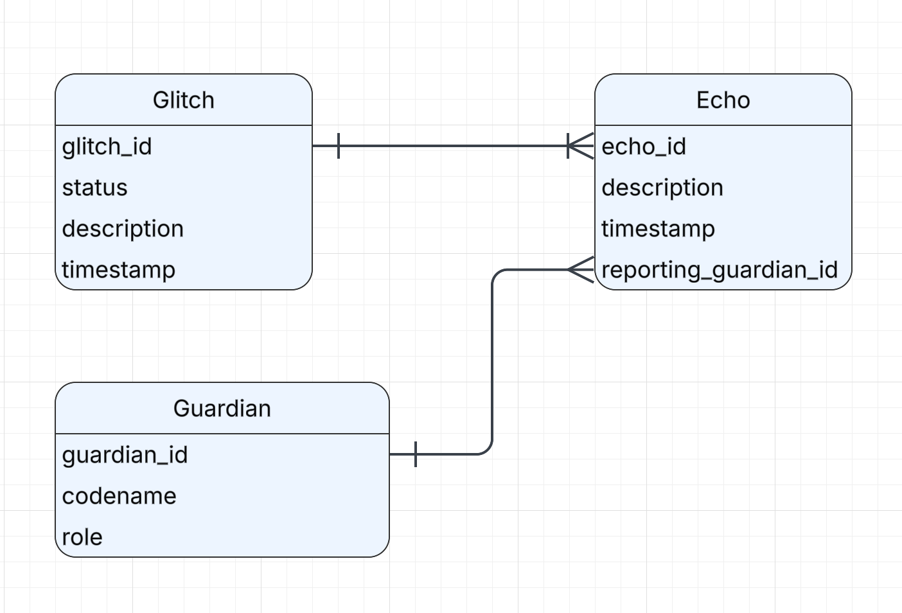

# Guardians of the Grid
Jullie bouwen een mission control center om Achrona te beschermen tegen The Desync. 
Dit  fungeert als de ultieme digitale levenslijn door vitale statistieken live in 
kaart te brengen en afwijkingen vroegtijdig te signaleren. Dankzij jullie realtime 
data-inzichten kunnen we op tijd ingrijpen om de glitches te stoppen en de magie 
in Achrona te redden

## Project setup
Deze repository bevat een basis [Tanstack Start](https://tanstack.com/start) op basis van:
- **Language:** [Typescript](https://www.typescriptlang.org)
- **Framework:** [React](https://react.dev)
- **ORM:** [Drizzle](https://orm.drizzle.team)
- **Styling:** [Tailwind](https://tailwindcss.com)
- **Build tool:** [Vite](https://vite.dev)

Om op te starten kan je volgende commando's gebruiken. 

```bash
npm install
npm run db:setup   # maakt local.db aan en vult ze met demo-data
npm run dev
```

Pas je `src/db/schema.ts` aan? Draai dan opnieuw `npm run db:setup` (wist en vult de database opnieuw).
Faalt dat (bv. na een grote schemawijziging), gebruik dan **`npm run db:reset`**: verwijdert `local.db` en maakt alles opnieuw aan. Stop eerst de dev server.

### Demo-accounts (lokaal)
| Codename | Rol | Wachtwoord |
|---|---|---|
| `nova` | commander (Guild master) | `achrona` |
| `ember` | defender (Adventurer) | `achrona` |
| `kael` | defender (Adventurer) | `achrona` |

### Thema: de guild van Achrona
In de code blijven de namen uit de opdracht; in de UI gebruiken we het guild-thema.

| Code | UI |
|---|---|
| glitch | monster |
| echo | sighting (observatie) |
| commander | guild master |
| defender | adventurer |
| `LEAKED` / `ASSESSING` / `CONTAINING` / `FIXED` | Spotted / Scouting / Engaged / Slain |

### Wereldkaart
- Het dashboard is een kaart van Achrona met regio's (Whispering Woods, Ember Peaks, Mirror Lake, Gloom Marsh, Sunscar Desert, Achrona City)
- Klik op een regio om in te zoomen: je ziet de monsters op hun locatie
- Klik op een monster voor de quest: rank (D–S), beloning in goud, party → **Accept quest** (adventurers)
- De guild master klikt op een locatie om danger (rank) en beloning in te stellen
- Wordt een monster `FIXED` (Slain), dan krijgt elk party-lid de beloning van die locatie → goud + leaderboard

### Datamodel
- `guardians` → `role_id` → `roles`; rechten per rol via `role_permissions` → `permissions`
- `sessions`: login-sessies (cookie `htf_session`, in de database enkel de SHA-256 hash van het token)
- `monsters`: de monster-index (bestiarium), met `danger` 1–5
- `regions` ← `locations` (x/y op de kaart, `danger` 1–5 en `reward` in goud, door de guild master)
- `glitches` → `monster_id`, `location_id`; `glitches` ← `echoes` (`glitch_id`, `reporting_guardian_id`)
- `glitch_assignments`: de quest-party (zelf geaccepteerd of door de guild master gestuurd)
- `bounties`: uitbetaald goud per (glitch, adventurer) wanneer een monster verslagen is
- Een nieuwe echo zonder glitch maakt automatisch een nieuwe glitch (`GL-xxxx`, status `LEAKED`) van het gekozen monstertype op de gekozen locatie
- Grootte van een monster = `danger` van het monstertype + groei per extra echo

## Beoordeling
> Hoe wij beoordelen wordt voor de start van de hackathon met alle studenten gedeeld, zodat dit meteen duidelijk is voor iedereen.

- **Creativity (40%):** Biedt de applicatie nieuwe, innovatieve of creatieve oplossingen? Steekt jullie applicatie er bovenuit t.o.v. de andere deelnemers?
- **Functionality (30%):** Welke functionaliteit hebben jullie kunnen voorzien tijdens de hackathon? Is de UI intuïtief en gebruiksvriendelijk? Zijn de functionaliteiten duidelijk voor de gebruikers zonder uitleg/handleiding?
- **Presentation (30%):** Trekt jullie presentatie onze aandacht? Is de presentatie duidelijk en helder over wat jullie gebouwd hebben? Zien we in jullie presentatie de input van alle deelnemers evenwaardig terugkomen?

## Basisopdracht
> Om alle opdrachten gelijkwaardig te beoordelingen, verwachten dit als minimale setup. 
> Hierna kiezen jullie zelf welke uitbreidingen jullie willen toevoegen.



Maak een webapplicatie waarin guardians kunnen inloggen. Eens ingelogd, zien ze een lijst met glitches.
Guardians hebben een role.
- Role `defender` kan echoes melden. Elke echo wordt standaard aanzien als een glitch 
- Role `commander` heeft dezelfde rechten als een defender + admin rechten
- Een echo heeft een `timestamp` en een `description`. 

## Uitbreidingen (Optioneel)
> Jullie kiezen zelf wat jullie willen toevoegen. Hieronder alvast wat inspiratie

### Workflow
- **Glitch status:** Een glitch doorloopt verschillende statussen (`LEAKED` → `ASSESSING` → `CONTAINING` → `FIXED`).
- **Zoek/Filters:** Guardians kunnen zoeken op keywords + data filteren en sorteren.
- **Glitches toewijzen:** Een commander kan glitches handmatig toewijzen aan een defender, die vervolgens via echoes updates geeft over deze glitch.
- **Reporting:** Maak de belangrijkste data exporteerbaar via PDF (voor de Hoge Raad van Achrona).
- **Keyboard shortcuts:** Navigeer door de applicatie met sneltoetsen (bv. <kbd>j</kbd> en <kbd>k</kbd> om de vorige/volgende glitch te bekijken).
- **Dark mode:** Zorg dat guardians kunnen switchen tussen dark en light mode. Voorzie evt. een extra lockdown mode die aanduidt dat er een grote aanval aan de gang is.

### Real-time monitoring
- **Live updates:** Nieuwe glitches worden real-time zichtbaar op het scherm.
- **Gauge chart:** Een visuele meter die de hoeveelheid magie in Achrona toont (100% als alles in orde is).
- **Interactieve kaart:** Een kaart (map) die exact toont wáár in Achrona een glitch plaatsvindt.
- **Sensor data:** Het systeem verwerkt IoT-sensordata en toont deze in grafieken op het dashboard.
- **Responsive design:** De applicatie werkt mobile-first en is volledig geoptimaliseerd voor smartphones.
- **Offline mode:** Data blijft beschikbaar bij netwerkuitval, met een duidelijke "offline"-indicator.

### AI Automation
- **Handle duplicates:** AI groepeert gerelateerde echoes automatisch onder dezelfde glitch; admins kunnen handmatig overriden.
- **Glitch types:** AI categoriseert het type en maakt dit visueel duidelijk (bv. met iconen of kleuren).
- **AI-moderation:** AI weert nutteloze echoes en scant beschrijvingen en afbeeldingen op illegale content.
- **Auto-closable glitches:** Glitches sluiten automatisch op basis van echoes (bv. "alles terug in orde"), maar heropenen ook als er een gelijkaardig nieuw probleem binnenkomt.
- **Predictive analysis:** AI maakt zelf glitches aan op basis van data-afwijkingen (bv. data-voorraad die in 5 minuten met 40% zakt).
- **Automatische toewijzing:** AI kiest zelfstandig welke defender het best past bij de glitch.
- **Create Runbook:** AI genereert een stappenplan (runbook) om het specifieke probleem op te lossen.
- **Chatbot:** Een ingebouwde assistent die vragen van operators over actieve incidenten en alerts beantwoordt.

### User engagement
- **Image uploads:** Users kunnen foto's uploaden bij een echo om de situatie te verduidelijken.
- **Speech-to-text:** Defenders op de vlucht kunnen echoes via hun microfoon inspreken i.p.v. te typen.
- **Verstuur notificaties:** Push-notificaties, e-mails of sms-berichten bij kritieke problemen (met instelbare voorkeuren per user).
- **Leaderboard:** Een klassement met badges voor de defenders die de meeste incidenten fixen.

